# Nix

A self-hosted workspace for one person or a small group: notes, tasks, habits, journal, files,
calendar and numbers in one item tree, on a laptop and on a phone. Everything stays exportable.

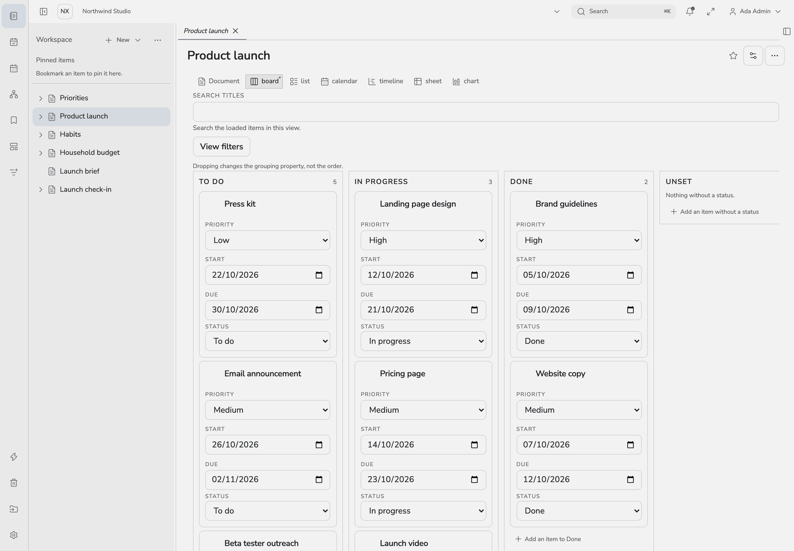

## What it does

- **One tree, many views.** A body (note, canvas or spreadsheet) is separate from how its children are
  shown: list, board, calendar, timeline, gallery, spreadsheet, chart, habit tracker, finance ledger.
- **Structure you shape yourself.** Property schemas, formulas, rollups, templates and automations,
  plus a companion that builds structure on request, with every plan previewed before it runs.
- **Real-time editing.** CRDT-synced notes with presence, version history and password-locked subtrees.
- **Quiet reminders and sync.** Due tasks and habits arrive as push notifications; Google and Outlook
  calendars sync both ways with a visible log.
- **Safe by construction.** Permissions are enforced by Postgres row-level security, and the web app,
  CLI and MCP server share one authorization path.
- **No lock-in.** Lossless `.nix` archives, plus PDF, DOCX and Markdown export; Markdown, DOCX, PDF
  and Obsidian import.
- **Scriptable.** `nixctl` is a JSON CLI, and `nixctl mcp` exposes the workspace to AI tools.
- **Publish a subtree** as a static site. This documentation is one: <https://nix.nixsites.com>.

The full list is in [docs/features.md](docs/features.md).

## Screenshots

One tree of items, shown the way each job needs. All data here is made up.

| | |
| --- | --- |
| 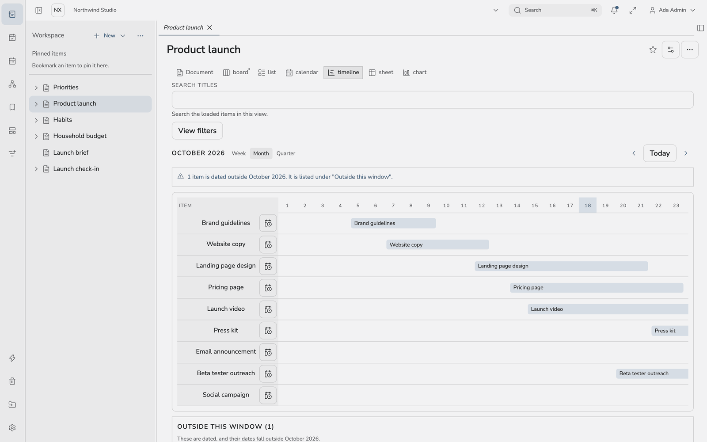<br>**Timeline** | 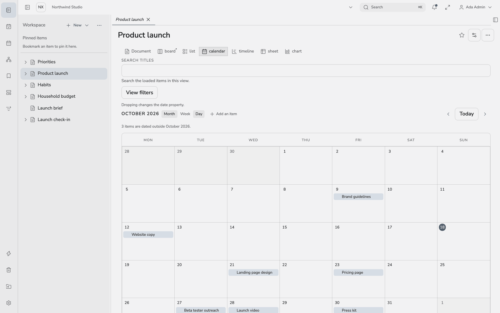<br>**Calendar** |
| 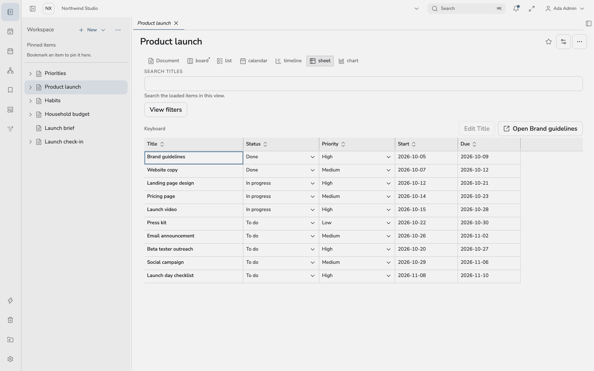<br>**Spreadsheet** | 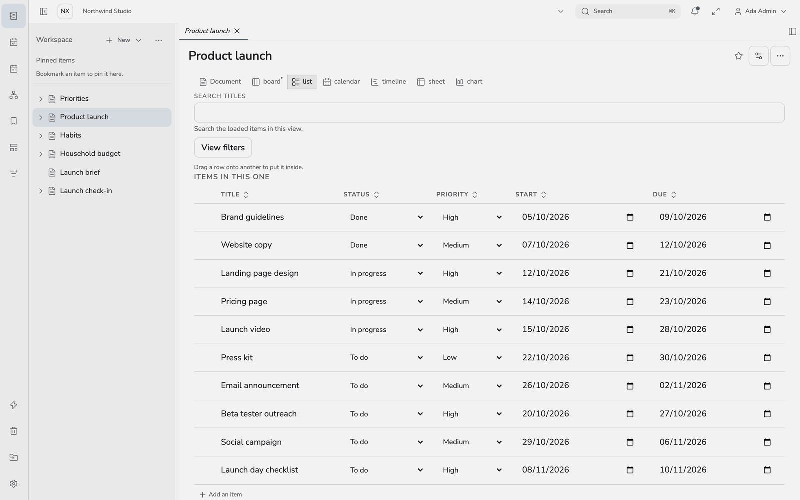<br>**List** |
| 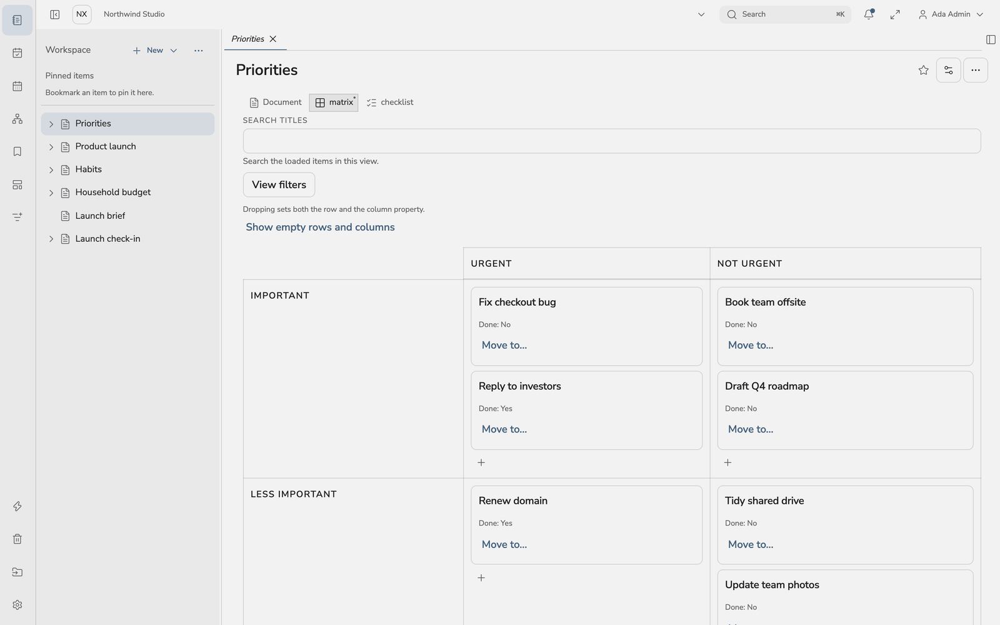<br>**Matrix** | 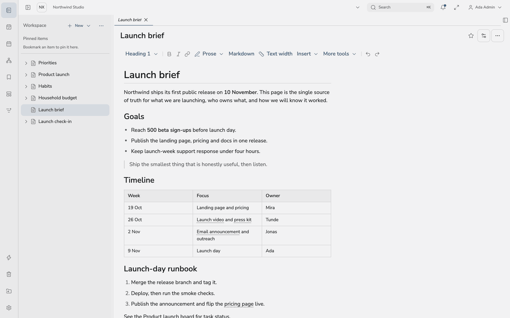<br>**Rich notes** |
| 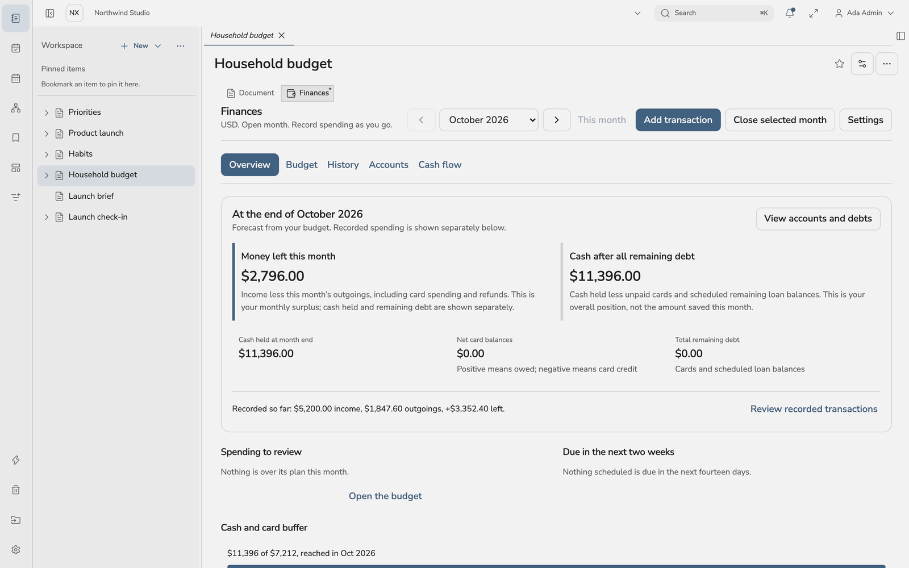<br>**Finance** | 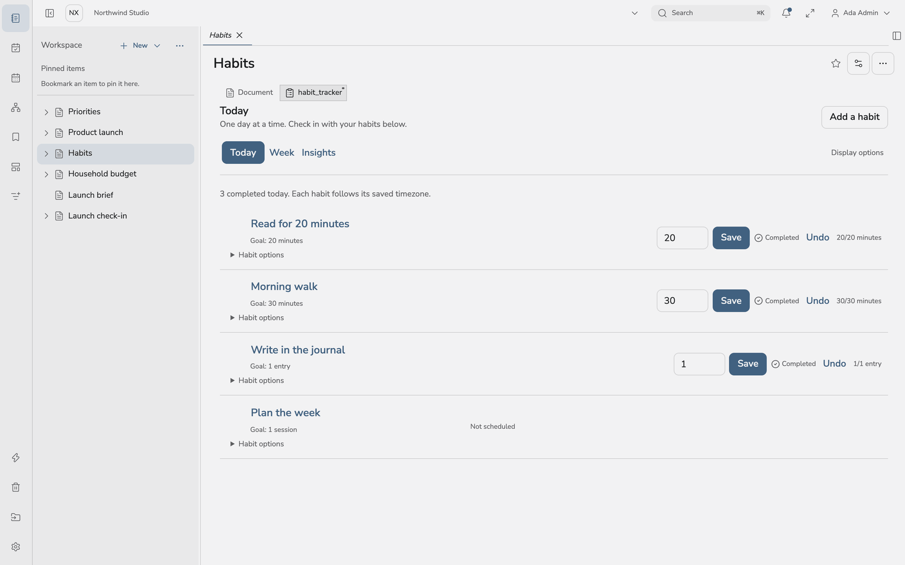<br>**Habits** |
| 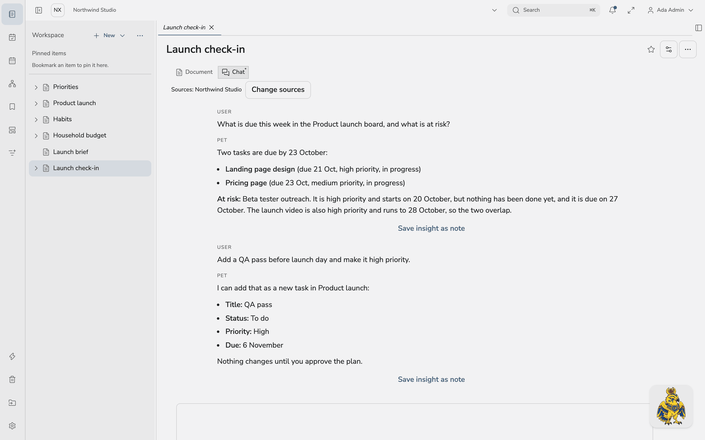<br>**Companion chat** | 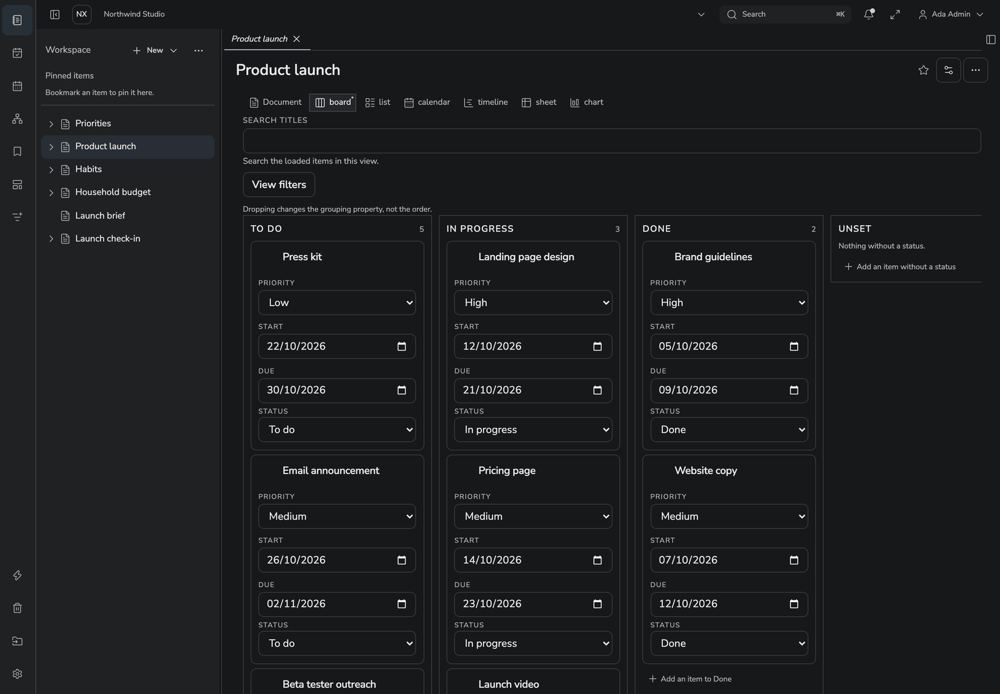<br>**Dark theme** |

**On a phone.** Nix installs as an app, with the same views, a share target and offline copies of notes you have opened.

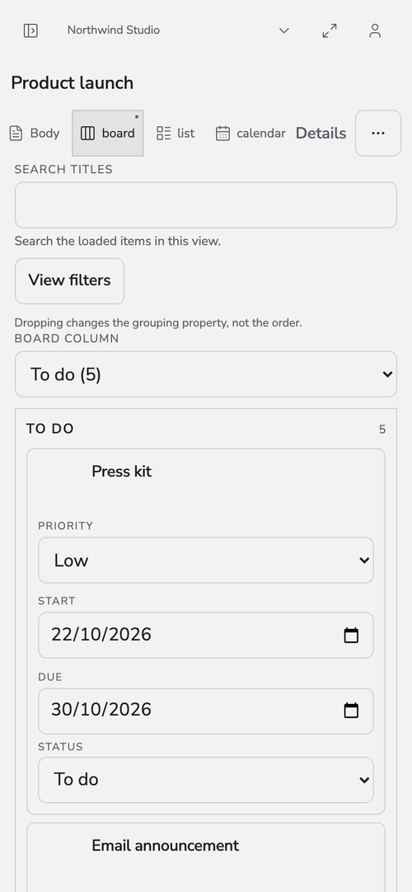 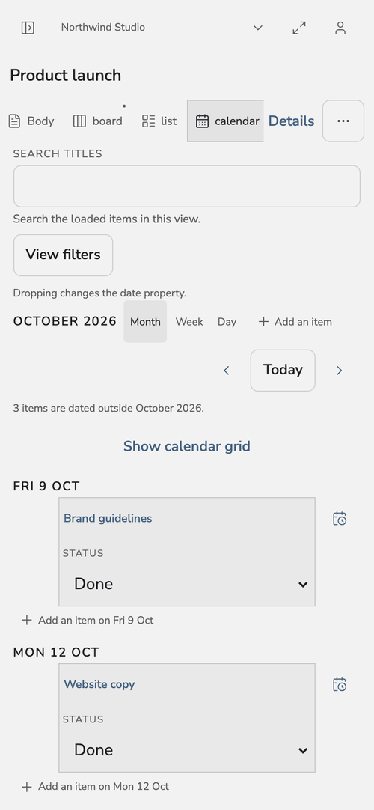 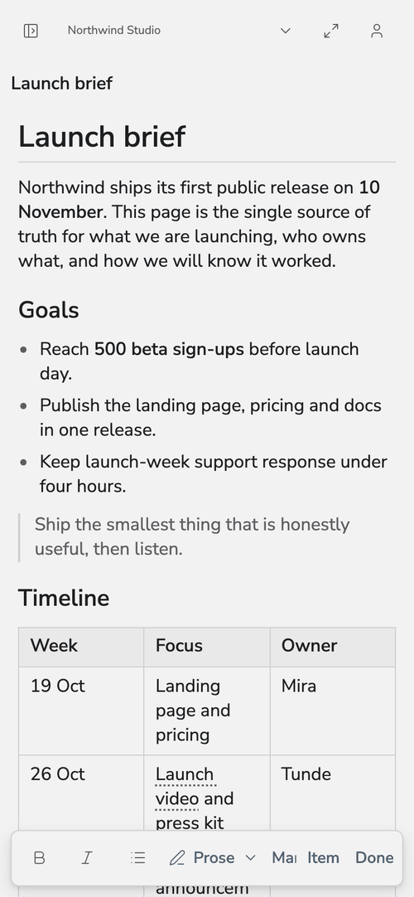 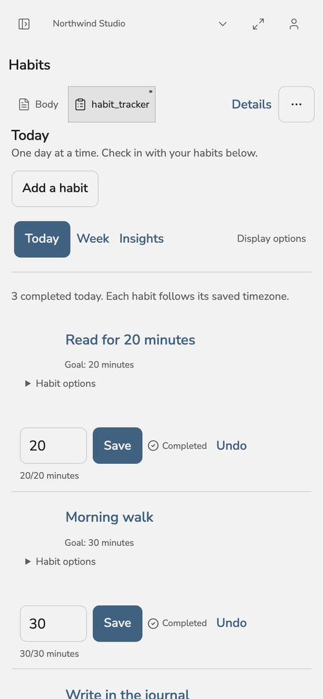 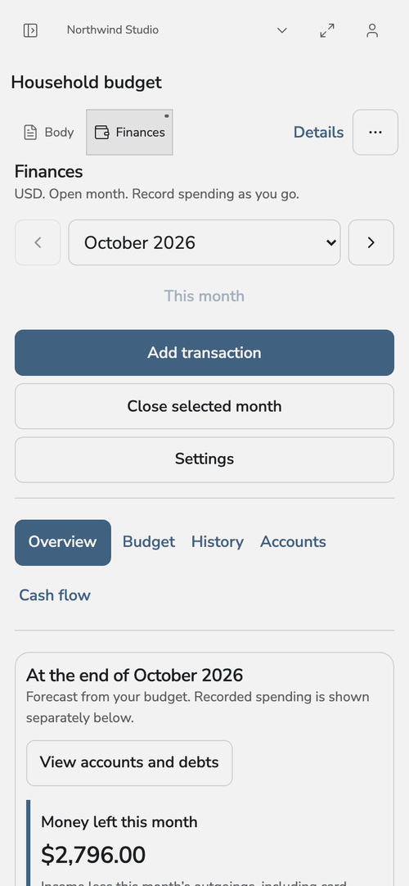 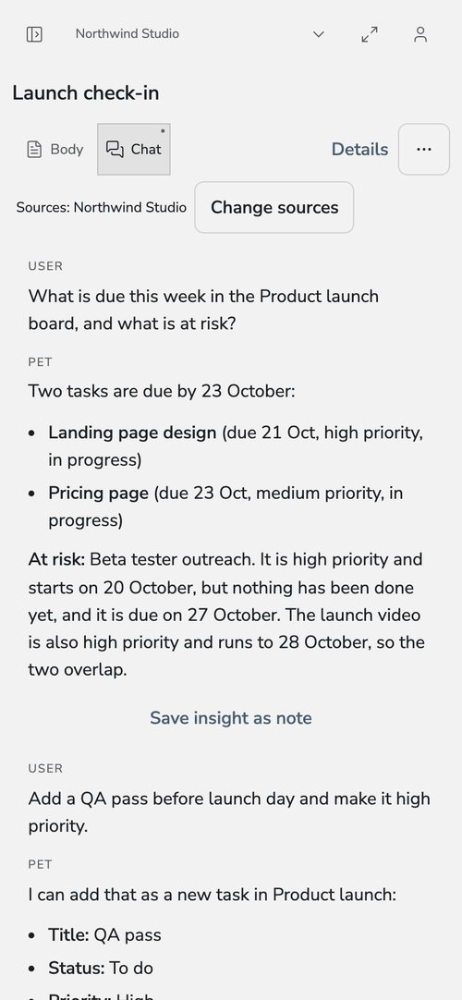

## Run it locally

You need [Docker](https://docs.docker.com/get-docker/) and [mise](https://mise.jdx.dev/).

```sh
git clone https://github.com/sianachi/nixsites.git && cd nixsites
mise install                       # Node, pnpm, .NET and Go at the pinned versions
pnpm install --frozen-lockfile
pnpm dev                           # infrastructure, database, identity, then every service
```

Open <http://localhost:5173> and sign in as `dev@nix.localhost` with `NixDev-Password1!`.
These are local development credentials only.

`pnpm dev` is safe to re-run. Use `bash scripts/dev.sh --help` to start only some services, or
`--skip-stack` when the Docker infrastructure is already up. If a port is taken, see `.env.example`.

Working in JetBrains Rider? `node --experimental-strip-types scripts/rider-run-configs.mts` writes
Run/Debug configurations for each service.

## Run it for real

Production is Docker Compose with CI-built multi-architecture images at `ghcr.io/sianachi/nix`.
Follow the [deployment guide](deploy/README.md) and the
[backup and restore guide](deploy/backup/production.md). Back up before every upgrade.

## Stack

ASP.NET Core 10 and Postgres 16 (row-level security, pgvector) · React 19, TypeScript, Tailwind v4 ·
Node 22 collaboration service (CRDT over WebSocket) · Go workers on RabbitMQ · OIDC login (Zitadel).

```
apps/web         React app, installable as a PWA
apps/collab      Collaboration service
apps/go-workers  Import, export, plugin, calendar and notification workers
apps/cli         nixctl and the MCP server
apps/sites       Static site builder and server
backend/         Core API (ASP.NET) and the migrator
packages/        Shared libraries
deploy/          Compose manifests, images, seed and backup scripts
```

## Contributing

Read [AGENTS.md](AGENTS.md) first; it links the focused guides for backend, frontend, workers and
validation. Day-to-day commands are in [docs/development.md](docs/development.md). Before opening a PR, run `./scripts/changed-path-checks.sh --working-tree` and then
`./scripts/validate-changed.sh --working-tree`. Generated OpenAPI and client code is never edited by hand.

Bug reports and ideas are welcome as issues.

## Licence

[MIT](LICENSE)
