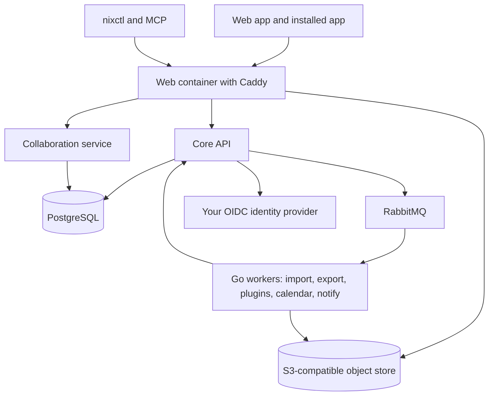

# Deployment

Nix is designed to run on hardware you control. There are two ways to run it in production, both from the same container images, which CI builds for every commit on `main` and publishes to the GitHub Container Registry for `linux/amd64` and `linux/arm64`:

- **Docker Compose** on one machine. This is the default target, with a one-command release script that backs up, migrates and smoke-tests.
- **Kubernetes** on a small k3s cluster, with the identity provider and the sites services included. It has to be chosen explicitly.

Start with the architecture, then pick a path.

## How the pieces fit

- **Core** (ASP.NET Core) is the only permission authority. It owns items, properties, views, jobs and sign-in.
- **Collaboration** (Node) stores document edits and history, and assembles imports and exports.
- **Workers** (Go) run background jobs. They never hold database credentials; they act through narrow, authorised APIs.
- **PostgreSQL** holds all durable state, with row-level security, and runs full-text search.
- **The object store** holds file bytes. Browsers reach it through short-lived signed links.
- **Sites**, when enabled, adds a build worker and a separate serving process for published websites.

